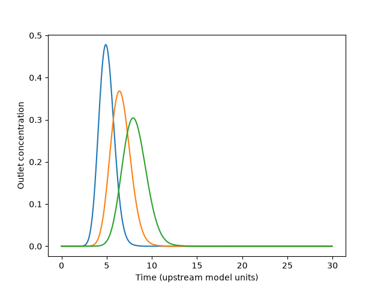
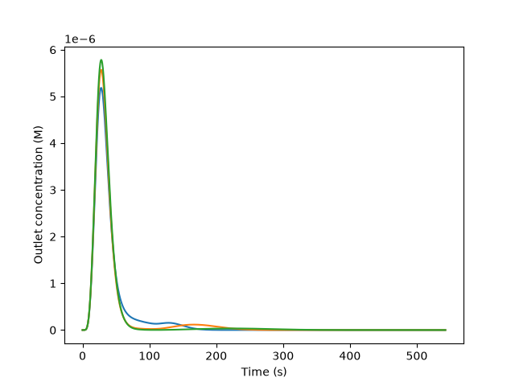

# 功能、授權與實測比較

研究截止：2026-10-13。固定SHA、提交日期、來源永久連結見[完整報告](github-research-report.md)。✓指源碼有該能力，**不代表本次已實測**；△需要參數／資料／修改；—未見該能力。Rt回歸與物理梯度求解分列，避免把「含梯度特徵」當「可解析任意梯度」。

## 功能矩陣

|專案|結構／序列→輸出|物理梯度→Rt|峰／寬／Rs|梯度搜尋|柱／條件轉移|不確定性／域|授權與採用|
|---|---|---|---|---|---|---|---|
|PyLSS|—|✓ RP LSS|✓近似寬/Rs/Gaussian|✓原生碼|△LSS欄轉移未驗證|—|AGPL3+；優先RP整合|
|GRIP|✓SMILES→LSS參數|✓分段LSS|—|—|△方法特徵|未見校準區間|無LICENSE；阻擋|
|STLC|—|△需溶劑參數依賴|✓PDE出口峰；Rs外加|—|△改參數|數值收斂須補|GPL3；數值對照|
|OpenIEX|—|✓鹽梯度傳輸|✓出口峰；Rs外加|—|△需交換參數|未見區間|MIT；先修正驗證|
|2-step|✓SMILES→ROI|—；anchor Rt映射|—|—|△target anchors|不等於prediction interval|AGPL3；校正候選|
|TIMPANI|✓Rt regression|—；條件特徵|—|—|△target-informed training|任務權重非信心|Apache2；訓練候選|
|MDL-TL|△結構特徵→Rt|—；梯度encoder|—|—|△fine-tune|未見區間|無LICENSE；阻擋|
|NonlinearGradientsUI|△外部Elude肽模型|—|圖／梯度表|✓洗脫密度均勻化|—|—|無專案LICENSE；理論|
|CADET-Core|—|✓給binding參數|✓傳輸峰|△外部流程|△重新參數化|敏感度不是區間|AGPL/GPL標頭冲突；門檻|
|CADET-Process FAU|—|✓Core adapter|✓比較／峰分析|✓最佳化框架|△參數估計|需資料統計校準|GPL3；架構候選|
|Graphormer-RT|✓RP/HILIC Rt專模|—；條件特徵|—|—|△訓練domain|未確認部署域檢查|整體／權重授權不明|
|DeepLC|✓肽／修飾→Rt|—|—|—|✓校正／head選擇|需target驗證|Apache2；肽類選配|
|RepoRT|資料不是模型|—|—|—|方法metadata|來源品質|CC-BY-SA4；資料選配|
|mzrtsim|—|—|✓指定／隨機Rt合成峰|—|—|—|GPL2；資料流程測試|
|舊Java HPLC|—|△已供保留參數|✓plate simulation|未確認|△已供參數|—|無LICENSE；理論|
|AutoLC-BO|—|✓多段LSS|✓Rt/width/Rs|✓Bayesian search|△retention params|BO surrogate非Rt可信度|CC-BY-NC-SA；排除預設商用|
|GNN-TL|✓GNN Rt|—|—|—|△HILIC transfer|未見區間|無LICENSE；理論|
|MIT QSRR|✓SMILES→Rt|—；既有method|—|—|未知method拒絕|✓descriptor range提示，非區間|MIT；結構選配|

沒有任何列已涵蓋全5模式、任意未知分子、峰形、可信度、手機網站。Source存在不代表不用實驗校準；無target Rt也不代表不需吸附參數。

## 隔離環境與重現命令

三個virtualenv位於 `C:/Users/T22016/AppData/Local/Temp/lc-gradient-research-20261013/venv-{pylss,stlc,openiex}`，各自editable安裝固定SHA的文字源碼。沒有修改上游核心。PyLSS不安裝PyQt6；測的是headless數值功能，GUI不能稱已重現。openiex額外裝ipywidgets供上游notebook進度條。

在工作目錄執行（TEMP需指向可持續的隔離快照）：

```powershell
$py = 'C:/Users/T22016/.cache/codex-runtimes/codex-primary-runtime/dependencies/python/python.exe'
& $py scripts/research/collect.py
& $py scripts/research/fetch-extra.py
& $py scripts/research/prepare-tests.py
# OpenIEX初次安裝在300秒超時，保留日誌後續跑：
& $py scripts/research/resume-openiex.py
& $py scripts/research/run-tests.py pylss stlc openiex
& $py scripts/research/generate-report.py
& $py scripts/research/generate-comparison.py
```

collect.py每次會重新解析HEAD，**不是自動固定版本重跑**。嚴格重現本報告需先用保存JSON的SHA下載codeload／git checkout到相同TEMP目錄，再跑prepare/run；不能用未來HEAD取代本次SHA。run-tests實際venv Python與probe命令逐字保存在各log開頭。probe.json保存Python與全部distribution版本，未使用lock安裝；未來應按這份版本清單建立lock以重現。需補完整源碼者可用固定SHA完整下載；此研究只提取文字檔，未載入權重。

每個probe輸入三組**合成分析物參數**，不是三個已經化學鑑定／SMILES推論的真實化合物。目的為驗證API、條件敏感性與濃度峰能產生；無法以此證明外部準確度。

|測項|PyLSS|STLC LKM|OpenIEX|
|---|---|---|---|
|三成分|3組logKw/S|3組吸附參數|鹽＋3種synthetic protein|
|比例／梯度變更|φi .05→.15；tg10→20min|無原生organic-gradient binding；明示未測|鹽.02→.5M；3→6CV|
|管柱變更|100→150mm；2.1mm內徑|模型長1→1.5|.01→.015m，半徑.002m|
|不用實測Rt|✓供logKw/S|✓供a/b/k/D等|✓供lnK/ν/σ/D/capacity|
|未知SMILES無參數|—|—|—|
|其他Python直接呼叫|✓|✓|依下列實際結果|
|峰／Rs|原生Gaussian、width/Rs|出口峰與本腳本FWHM-Rs|出口峰與本腳本FWHM-Rs|
|不確定性|未見校準區間|步長敏感性，非統計區間|未見校準區間；solver狀態缺失|

## 實際輸出與失敗紀錄

### pylss

狀態：`PASS_HEADLESS_API`；Python `3.12.14`。[數值／版本JSON](research-evidence/pylss-probe.json)、[stdout與命令](research-evidence/pylss-probe.log)、[安裝日誌](research-evidence/pylss-install.log)。

|L mm|tg min|φi|三個Rt min|原生最小Rs|
|---|---|---|---|---|
|100|10|0.05|5.627884, 6.407900, 7.031319|8.425687|
|100|20|0.05|8.521715, 10.226215, 11.610521|10.957177|
|100|10|0.15|4.839449, 5.695721, 6.398598|8.722674|
|150|10|0.05|6.499959, 7.232656, 7.814472|8.378600|

零梯度實際回傳 `9999`；NLSS import：`{'status': 'FAILED', 'error': 'ModuleNotFoundError("No module named \'optimizer\'")'}`。此模組失敗不隱藏在headless PASS之下。上游[pytest日誌](research-evidence/pylss-upstream-tests.log)實際6項通過。第一次probe因本研究脚本原命名inspect.py遮蔽stdlib失敗，已改名；[初次日誌](research-evidence/pylss-probe-attempt1.log)保留，這不是上游bug。

限制：Requires supplied logKw/S, no structure prediction; GUI dependencies omitted.

### stlc

狀態：`PASS_SYNTHETIC_TRANSPORT`；Python `3.12.14`。[數值／版本JSON](research-evidence/stlc-probe.json)、[stdout與命令](research-evidence/stlc-probe.log)、[安裝日誌](research-evidence/stlc-install.log)。

|條件|三個峰頂Rt|三個FWHM|近似相鄰Rs|有限／終點|
|---|---|---|---|---|
|L=1.0,dt=0.05|4.9, 6.4, 7.9|1.9, 2.55, 3.05|0.397753, 0.316071|True|
|L=1.5,dt=0.05|7.15, 9.45, 11.7|2.35, 3.1, 3.8|0.497982, 0.384783|True|
|L=1.0,dt=0.025|4.9, 6.4, 7.925|1.775, 2.375, 2.9|0.426506, 0.341137|True|

時間單位遵循上游模型，不自行轉成分鐘。dt減半後峰頂約4.9/6.4/7.925，峰寬與Rs仍變動；微小負濃度及收斂／守恆未解。

限制：No native solvent-gradient-dependent binding API in lkm; not SMILES prediction.

### openiex

狀態：`EXECUTED_REVIEW_REQUIRED`；Python `3.12.14`。[數值／版本JSON](research-evidence/openiex-probe.json)、[stdout與命令](research-evidence/openiex-probe.log)、[安裝日誌](research-evidence/openiex-install.log)。

|條件|三個峰頂Rt|三個FWHM|近似相鄰Rs|有限／終點|
|---|---|---|---|---|
|L=0.01m,gradient=3CV|28, 28, 28|23, 22.5, 23|0, 0|True；542.759/542.759s|
|L=0.01m,gradient=6CV|28, 28, 28|23, 22.5, 23|0, 0|True；768.908/768.908s|
|L=0.015m,gradient=3CV|42.5, 42.5, 42.5|35, 33.5, 34|0, 0|True；814.138/814.138s|

初次pip安装300秒超時；重試[完整日誌](research-evidence/openiex-install-resume.log)EXIT0。上游沒有自動測試套件結果可宣稱。

平衡參數補測：`{'forward': -1.0, 'reverse': 2.0, 'expected_reverse': 1.0}`；序列化往返一致：`False`。原生wrapper沒有success/message，回傳到預定終點及finite只能作必要檢查，不能證明成功收斂。

**梯度敏感性未證實**：這組synthetic proteins在約27–29秒已有峰，梯度約90.46秒才開始；改gradient CV無法以早期峰證明保留響應。初次401格點隨總時長改變，Rt微差可能只是取樣。已改用共同0.5秒間距重跑；[初次取樣JSON](research-evidence/openiex-probe-original-sampling.json)與[初次stdout](research-evidence/openiex-probe-original-sampling.log)另存。部分成分峰頂相同、Rs=0；三成分成功輸入不等於成功分離。必須重新選擇經驗證的保留參數與校驗平衡式，才能測真正梯度洗脫。



限制：Synthetic protein parameters; reverse lnK bug; wrapper omits solve_ivp success flag. No structure predictor.

## 三套測試的正確解讀

PyLSS通過的是RP headless API與6個上游單元測試，不包含GUI、HILIC、資料校正或外部準確度。STLC通過的是給定參數的三成分傳輸運算，不包含有機相梯度／GRM／網格收斂。OpenIEX的EXECUTED_REVIEW_REQUIRED只表示已執行；平衡參數、序列化、solver與峰的問題阻止直接判定科學可靠。

所有其他repo均為來源分析，未做本機功能測試。CADET有成熟上游測試，不等於本機已通過；GRIP／Graphormer權重存在，不等於已成功推論。無模型檔、舊環境或無授權導致未測的原因見[逐repo報告](github-research-report.md)。

## 比較路線與最終決策

詳見[九項開發路線比較](recommended-architecture.md)。方案A fork任何單一候選均缺大量產品／模式能力；方案B最能重用現有RP与傳輸模块、保留各模式的科学邊界；方案C法律与接口控制较强但須承擔核心科學驗證。沒有完整需求拆分工時基線，因此不列覆蓋／節省精確百分比。

唯一首選B；唯一備選C。研究結束後等待採用確認，不开始網站實作。
