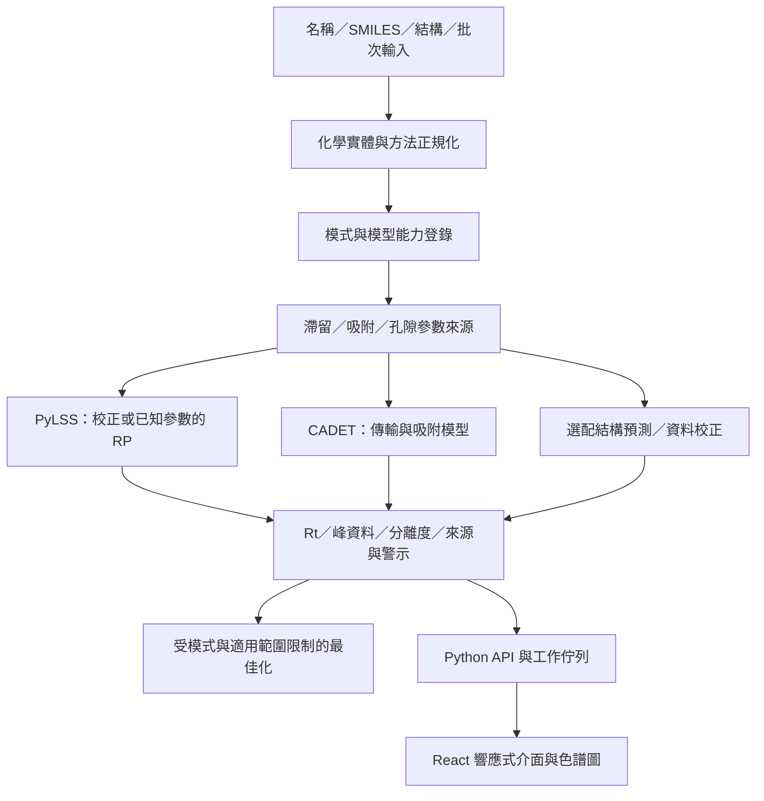

# LC Gradient Studio：建議整合架構

研究日期：2026-10-13（Asia/Taipei）。本文件是設計評估，沒有實作正式平台。固定版本、程式證據、可執行範圍見 [調查報告](github-research-report.md)、[測試矩陣](open-source-comparison.md) 與 [授權審查](license-review.md)。

## 唯一首選：方案 B，新 Repository 整合現有科學模組

**組合：PyLSS 的 RP 計算核心 + CADET-Process／CADET-Core 的傳輸模型 + 自有的模式、參數、適用範圍與 API 層。** 資料校正為可選能力，優先研究 2-step；結構機器學習擴充研究 TIMPANI、MIT 的 hplc-retention-prediction；肽類另用 DeepLC。這些不是第一階段必裝依賴，也不能彼此直接交換模型輸出。

選此方案的前提是願意履行所採元件的 copyleft 義務；新產品授權尚未設定。PyLSS 是目前**最值得優先整合並已實測的 RP 科學模組**。CADET-Process 是**最值得借用的科學運算主架構**，有 component system、unit operation、事件、求解器、比較與最佳化的分層；它不是可直接 fork 就變成多模式分子預測網站的完整產品。CADET-Core 的 LICENSE／檔案標頭衝突，及本機執行可行性，必須先過版本與法律門檻。

GRIP 的「結構 → LSS 參數 → 梯度 Rt」最貼近需求，但固定 commit 沒有授權；**目前不列為首選組合的可重用程式碼或權重**。Graphormer-RT、MDL-TL、GNN-TL 也先排除直接重用，理由見授權文件。不能以改寫 API 或換語言消除原授權義務。

## 模組邊界與資料流

這只是建議資料流。ML 若只輸出 Rt 或 ROI，應進入其專屬結果路徑；**不能把 Rt 當成 logKw/S 或 SMA 參數送進物理引擎**。圖中的 Params 亦可直接由已知參數、校正資料供應，不要求每個分子都有 ML 預測。

科學運算在伺服器端 Python／原生求解器執行，React 接收標準化 JSON。快速解析模型可同步計算；PDE、多候選最佳化與批次推論採背景工作，取消舊請求、防止過時結果覆蓋新梯度。即時更新必須量測延遲，不能把本次可行性測試等同手機互動效能。

建議共用契約包含：chemical entity 種類、LC mode、method revision、管柱幾何與固定相化學、完整梯度節點、溶劑與添加物、pH／溫度／流量／dwell volume，以及每個參數的單位、來源、校正條件與可信區間。結果須記錄 commit／模型 hash、是否洗脫、求解成功與否、Rt 的取法（apex／moment）、峰寬定義、Rs 定義及適用範圍狀態。未建模條件應明確回報，不能默默套用預設。

## 五種模式必須分開

| 模式 | 候選引擎與條件 | 必須補足的科學工作 |
|---|---|---|
| RP | PyLSS：稀溶液、已知或已校正 logKw/S；CADET 可承接更完整傳輸 | 多段梯度、等度邊界、pH／溫度依賴、固定相變更參數與域外判斷 |
| HILIC | 獨立經驗或混合機理模型；Graphormer-RT 僅為待授權研究候選 | 分配／吸附／離子作用、含水量方向與非單調保留；PyLSS 的 NLSS 現況不能視為成熟 HILIC |
| NP | 可重用傳輸求解器，吸附模型另建 | 溶劑競爭吸附、表面水活性、分析物／固定相參數與驗證資料 |
| IEX | CADET 的 SMA／GeneralizedIonExchange；OpenIEX 為原型參考 | ν、σ、容量、動力學及 pH 依賴必須估計／校正；不能只由形式電荷推出可靠 Rt |
| SEC | 可重用無吸附傳輸、孔隙可及性模型；須獨立驗證 | 水動力體积與孔徑分布、分配係數、聚合物分散性；分子量不等於唯一洗脫參數 |

名稱解析和結構繪製只改善輸入，不會產生不存在的物理參數。未知身份／結構的混合物只能作參數化成分或量測特徵，不能提供真實分子特異 Rt。寡聚物、聚合物和生物分子須有專屬表示；小分子 SMILES 模型不能宣稱覆蓋它們。

## 可結合與不宜結合

- PyLSS + CADET：共用結果格式與最佳化目標，使用分別校正的模式／参数；不直接混合兩者的單位或峰寬公式。
- 2-step + 量測 anchors：可選 RP Rt 校正服務。ROI 不適合當梯度動力學參數，也不能無 anchors 宣稱真實 Rt。
- TIMPANI + RepoRT：適合少量目標條件資料的訓練研究；尚缺現成權重與獨立完整重現。
- DeepLC：肽序列與修飾的專用子模組。其預設 head 的 Rt 不是任意新梯度的 Rt。
- STLC：數值基線及測試對照，避免與 CADET 同時成為正式平台的兩套主求解器，增加維護負擔。
- OpenIEX：可重用的 MIT 原型，但在反向 lnK、序列化及求解狀態問題完成修復驗證前，不作正式 IEX 基準。
- AutoLC-BO：多段梯度／目標函數理論值得借鑑，NC 授權排除預設商業整合。NonlinearGradientsUI 是分布均勻化，不能取代 Rs 最佳化。

## 三路線比較

| 面向 | A：Fork 一個既有專案 | B：新專案整合模組（首選） | C：自行核心、選用演算法（備選） |
|---|---|---|---|
| 功能覆蓋 | PyLSS 偏 RP；CADET 偏已知參數過程模擬；沒有完整候選 | 可組合 RP 與多成分傳輸、選配校正；輸入／推薦仍自建 | 初期覆蓋較少，需自行完成方程式邊界與驗證 |
| 科學可靠度 | 保留局部模型，但容易把原範圍誤當通用 | 獨立模式與來源約束較清楚；須交叉验证 | 完全取決於自行驗證；無上游數值回歸可依靠 |
| 修改難度 | 老 GUI 與原假設牽動大 | adapter／契約／單位轉換成本中高 | 數值與產品都要設計，難度最高 |
| 衝突風險 | 原程式架構限制、多模式改動與上游同步 | chemprop 1.x／2.x、NumPy、PyTorch／DGL 等須分環境 | 套件衝突可少一些，科學模型失誤風險高 |
| 授權 | 直接衍生原專案，原 copyleft 明顯 | 同樣須履行 copyleft；服務分界不是免責 | 可自選原創碼授權，但不得逐行翻寫未授權碼 |
| 網頁化 | Qt／Java 介面需置換；CADET 仍需產品層 | Python worker 可包 API，React 自建 | 所有服務與產品層自建 |
| 多模式擴充 | 原假設易耦合 | 模式專屬 adapter，擴充最清楚 | 自由度高但每模式都需從零驗證 |
| 維護成本 | Fork 長期追上游加多模式分支 | 多依賴成本，用少數主引擎與固定版本管理 | 科學與求解器維護成本最高 |
| 可減少工作 | 局部 UI／RP 計算，無證據替代整个平台 | 不重寫解析 RP 核心、傳輸離散與求解器、現有校正模組 | 主要節省基礎數值庫與算法研究，省下較少核心實作 |

沒有估工基線、驗證資料與相同工作分解，**不報覆蓋率或省工百分比**。可明確省下的是列出的完整模組，無法省下的是統一產品層、模式參數化、模式推薦與可信度驗證。

## 唯一備選

**方案 C：自建模式契約與經獨立驗證的簡化 RP／SEC 核心，採寬鬆授權基礎數值／化學工具，OpenIEX 只在問題修正後作候選；不引入 AGPL 或未授權模型碼。** 適用於不能接受首選的授權公開義務，或 CADET 部署門檻未通過時。這條路省工較少，初期功能必須縮限；不能因此承諾無資料、全模式、未知化合物都可靠。

未找到能取代原需求大部分完整開發工作的單一開源專案。最接近可重用的是科學計算層，尚非所要求的多模式預測與最佳化產品。
